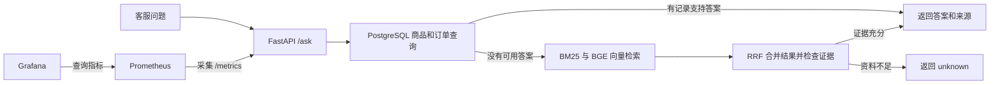

# 星河书店智能客服 RAG

一个用 **FastAPI、PostgreSQL、BM25、BGE、FAISS** 实现的中文客服练习。输入商品、订单或政策问题，API 返回答案、来源和经过的处理步骤。案例数据来自虚构书店。

## 一个请求怎么走



- 查询优先走参数化 SQL。数据库连接失败时，依赖该查询的请求返回 HTTP 503。
- FAQ 检索对关键词排名和向量排名做 RRF 融合。规则检查引用片段是否覆盖当前问题所需的信息。
- 每个 API 进程缓存最近使用的 256 个问题向量，重复问题仍会执行检索和证据检查。
- Grafana 面板显示请求量、HTTP 错误率、平均延迟和采集状态。

## 本地运行

需要支持 Linux 容器的 Docker 和 Compose v2，首次运行需要能访问 Docker Hub、PyPI、PyTorch CPU 软件包源和 Hugging Face。CPU 推理使用固定版本的 BGE 中文模型，模型缓存保存到 Docker 命名卷。 [BGE 模型](https://huggingface.co/BAAI/bge-small-zh-v1.5/tree/7999e1d3359715c523056ef9478215996d62a620)

在仓库根目录执行。

```bash
docker compose up -d --build --wait --wait-timeout 300
```

| 入口 | 地址 |
| --- | --- |
| FastAPI Swagger | [127.0.0.1:8150/docs](http://127.0.0.1:8150/docs) |
| Prometheus | [127.0.0.1:9150](http://127.0.0.1:9150/) |
| Grafana 看板 | [127.0.0.1:3150](http://127.0.0.1:3150/d/agentguide-customer-rag) |

这套 Compose 用于本机展示。网页只绑定回环地址，PostgreSQL 使用隔离网络内的演示认证。已有相同版本的 Hugging Face 缓存时，可以用环境变量 `RAG_MODEL_CACHE` 指向该目录（包含 `hub/`），同时设 `RAG_MODEL_OFFLINE=1`，复用现有文件。Windows Docker Desktop 的模型卷和构建缓存随 Docker 数据盘存放。

## 试一次问答

打开 Swagger 的 **POST /ask → Try it out**，提交下列请求。

```json
{"question": "BOOK-001 是什么书，多少钱？"}
```

```json
{
  "route": "database",
  "sources": ["product:BOOK-001"],
  "answer": "BOOK-001 是《Python 入门》，价格 59 元。",
  "trace": ["检查精确查询"]
}
```

问「图书退货需要哪些条件？」会返回 FAQ 引用。问「退货申请提交后，退款几天到账？」会返回 `unknown`。

PyCharm 可右键运行 [scripts/verify_stack.py](scripts/verify_stack.py)，参数留空。脚本检查六个业务样例、一个空白输入、Grafana 看板和 Prometheus 采集状态。结束演示时用 `docker compose stop`，数据卷会保留。

## 性能与范围

第一个课程项目曾在同机 Docker 上做 4 个 Locust 用户、约 20 秒的六题混合对照。关闭查询向量缓存时为 **88.95 QPS、P99 87 ms**，开启缓存并预热重复题后为 **538.25 QPS、P99 13 ms**，两轮均无失败。这组证据适用于预热后的重复教学问题，实际持续吞吐及自动解决率需要代表性业务数据。 [课程基准记录](docs/benchmark.md)

项目按 AgentGuide 开发岗路线完成。 [AgentGuide](https://github.com/SHZ472/AgentGuide)
